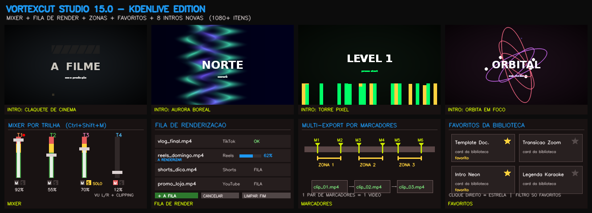

# VortexCut Studio

Editor de vídeo para Windows. Este repositório publica o instalador; o código-fonte da aplicação não é disponibilizado aqui.

## Versão atual: 15.0 "Kdenlive Edition" (inspirada no Kdenlive/KDE)

- **Mixer de áudio por trilha** — fader de volume 0–200 %, Mudo e Solo (aditivo), VU meter estéreo com indicador de clipping; o volume/solo valem também na exportação.
- **Fila de renderização (jobs)** — enfileira várias exportações e continue a trabalhar; progresso, estado e cancelamento por job, como no Kdenlive.
- **Zona de exportação** — exporta só o intervalo definido (Ctrl+Shift+Z), salvo no projeto.
- **Multi-Export por marcadores (Marker Zones)** — cada par de marcadores da timeline vira um vídeo independente.
- **Operações de trilha (26.08)** — cor do cabeçalho, reordenar para cima/baixo, silenciar/ocultar/bloquear.
- **Favoritos universais da biblioteca** — estrela em qualquer card + filtro "Só favoritos", persistência local.
- **Biblioteca com 1080+ itens** — +8 intros animadas e +20 templates de edição novos.

### Também na 14.0 "Social Edition"
- Auto-Reframe por quadro (fundo desfocado estilo CapCut), presets TikTok/Reels/Shorts com limite de duração, 6 transições 3D, exportação em lote com reframe.

### Também na 13.0 "Openput Edition"
- Abertura 3D cinematográfica com camadas em perspetiva, comparação Antes/Depois (A/B), mini-mapa navegável da timeline.

## Instalar

1. Abra [Releases](https://github.com/kenjunior01/VortexCutStudio/releases/latest).
2. Descarregue `VortexCutStudio_Setup.exe`.
3. Execute o instalador e siga os passos apresentados.

**Requisitos:** Windows 10 ou 11, 64 bits. O instalador inclui o FFmpeg necessário para as funções de vídeo.

O Windows pode mostrar um aviso de editor não verificado porque o instalador não tem assinatura digital. Descarregue-o apenas da página oficial de Releases e confirme o SHA-256 publicado nessa página.

## Licença

A aplicação é proprietária. É permitido descarregar, instalar e usar o instalador oficial sem modificações. Consulte [LICENSE.txt](LICENSE.txt). O FFmpeg e as fontes DejaVu incluídos mantêm as respetivas licenças de terceiros, disponibilizadas com o instalador.

## Ajuda

Para reportar um problema, abra uma [issue](https://github.com/kenjunior01/VortexCutStudio/issues) e inclua a versão do Windows e os passos para reproduzi-lo. Não anexe vídeos privados ou dados pessoais.
