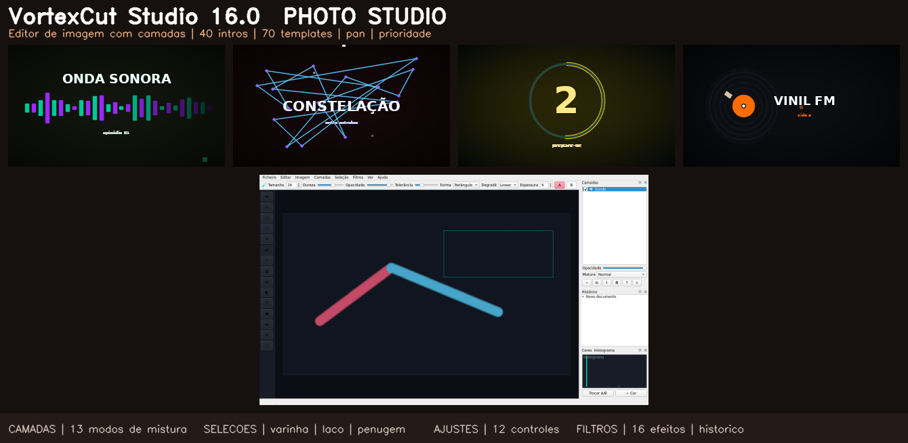

# VortexCut Studio

Editor de vídeo + editor de imagem para Windows. Este repositório publica o instalador; o código-fonte da aplicação não é disponibilizado aqui.

## Versão atual: 16.1 "Photo Studio+" — vídeo + edição de imagens completa

**Novo na 16.1 (Estúdio de Imagem):** **Curvas interativas** (Ctrl+M, canais RGB/R/G/B com histograma), **pincéis de retoque** Clarear/Escurecer/Desfoque local/Nitidez local (D/J/K/P), **Transformar camada** (Ctrl+T: escala, rotação, translação, flips), **Duotone / Mapa de gradiente** com presets, filtros **Cartoon · Halftone · Lomo · Brilho suave (Orton)**, **expandir/contrair seleção** e **histograma R·G·B**. Guia completo: `GUIA-ESTUDIO-IMAGEM.md`.

- **Estúdio de Imagem** — documento com **camadas** (visibilidade, opacidade, **13 modos de mistura**), **pincel/lápis/borracha/carimbo de clone**, **balde**, **degradê**, **formas**, **texto rasterizado** e **conta-gotas**.
- **Seleções profissionais** — retângulo, elipse, laço livre e **varinha mágica** com tolerância + penugem; pintura e filtros respeitam a seleção.
- **Ajustes com preview ao vivo** (brilho, contraste, saturação, matiz, exposição, gama, temperatura, vibrância, clareza, níveis) e **16 filtros** (desfoques, nitidez, relevo, bordas, pixelizar, posterizar, ruído, vinheta, glitch RGB, P&B, sépia, threshold, auto-contraste).
- **Histórico de 20 passos** clicável, zoom Ctrl+roda, histograma em tempo real, girar/espelhar/redimensionar/cortar.
- **🎬 Enviar para a linha de tempo** — a imagem acabada entra no projeto de vídeo como mídia.
- **70 templates de edição · 38 looks de legenda · 40 intros animadas** (série 15).

### Também na 15.2 "Pro Update"
Pan equal-power por trilha no mixer, prioridade ↑/↓ na fila de renderização, favoritos exportáveis em JSON, 13 presets de speed ramping.

### Também na 15.0 "Kdenlive Edition"
- Mixer de áudio por trilha (fader, mudo, solo, VU meter com clipping), fila de renderização com progresso, zona de exportação, multi-export por marcadores, favoritos universais e biblioteca com 1080+ itens.

## Instalar

1. Abra [Releases](https://github.com/kenjunior01/VortexCutStudio/releases/latest).
2. Descarregue `VortexCutStudio_Setup.exe`.
3. Execute o instalador e siga os passos apresentados.

**Requisitos:** Windows 10 ou 11, 64 bits. O instalador inclui o FFmpeg necessário para as funções de vídeo.

O Windows pode mostrar um aviso de editor não verificado porque o instalador não tem assinatura digital. Descarregue-o apenas da página oficial de Releases e confirme o SHA-256 publicado nessa página.

## Licença

A aplicação é proprietária. É permitido descarregar, instalar e usar o instalador oficial sem modificações. Consulte [LICENSE.txt](LICENSE.txt). O FFmpeg e as fontes DejaVu incluídos mantêm as respetivas licenças de terceiros, disponibilizadas com o instalador.

## Ajuda

Para reportar um problema, abra uma [issue](https://github.com/kenjunior01/VortexCutStudio/issues) e inclua a versão do Windows e os passos para reproduzi-lo. Não anexe vídeos privados ou dados pessoais.
